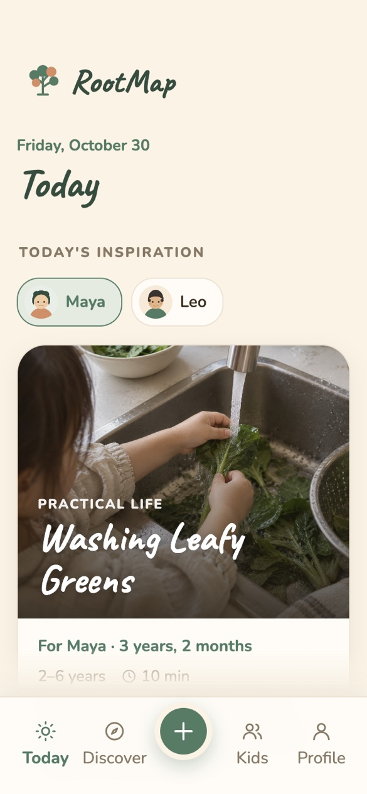
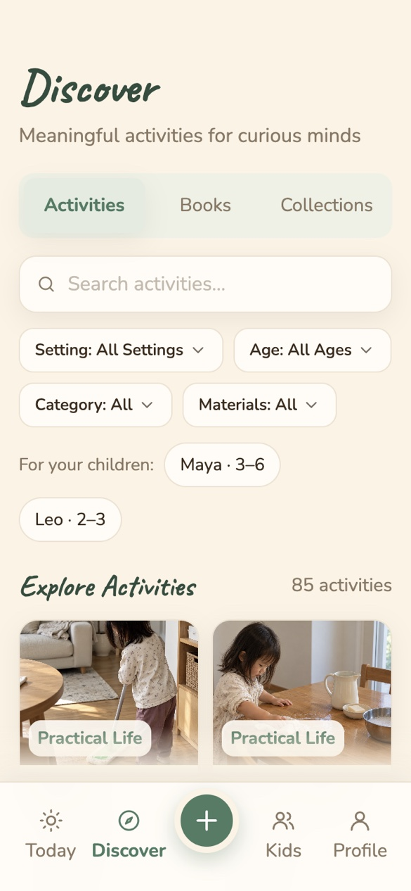
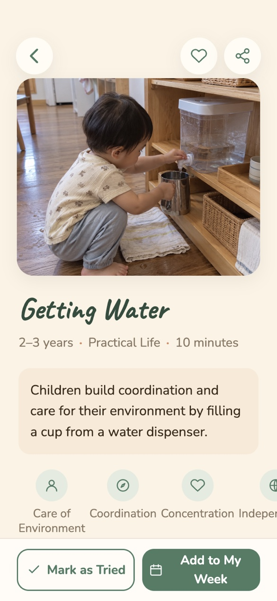
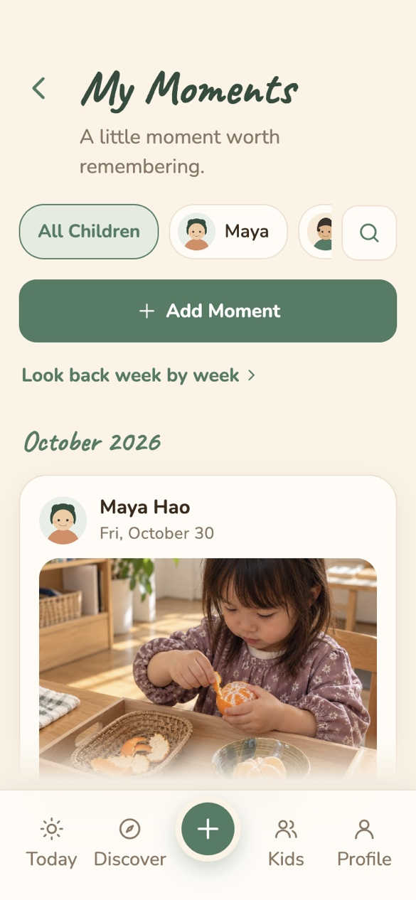
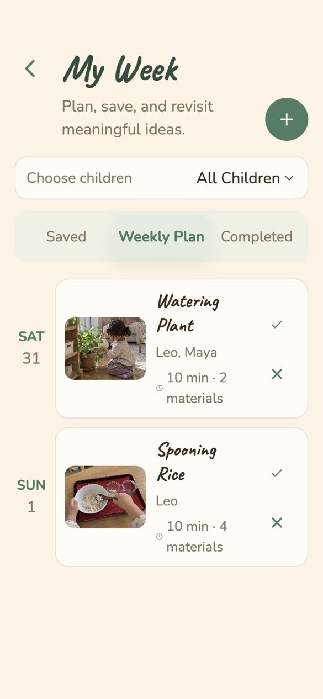
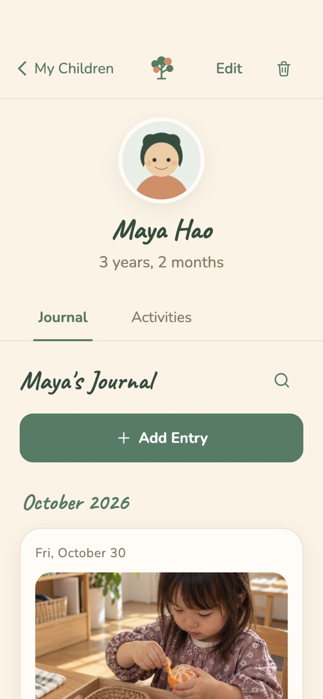

<p align="center">
  
</p>

<h1 align="center">RootMap</h1>

<p align="center">
  A calm, Montessori-inspired companion for parents of young children.<br>
  Find meaningful things to do together, keep the moments that matter, and see your child grow.
</p>

<p align="center">
  <a href="https://vegalh.github.io/rootmapmvp/"><strong>Try the web app</strong></a>
  &nbsp;·&nbsp; English &amp; 简体中文 &nbsp;·&nbsp; Web &amp; iOS
</p>

---

## About

RootMap is for parents and caregivers of toddlers and preschoolers (roughly ages 1 to 5), especially families drawn to Montessori ideas of independence, repetition and careful observation.

Each day it suggests one hands-on activity suited to each child's age, with clear steps and a materials list drawn from everyday home life. When something happens worth remembering, a parent can save it as a short moment with a photo. Over the weeks, those moments and activities build into a simple record of how each child is growing.

## Screenshots

<table>
  <tr>
    <td align="center" width="33%"><br><sub><b>Today</b>: one idea per child</sub></td>
    <td align="center" width="33%"><br><sub><b>Discover</b>: activities, books and collections</sub></td>
    <td align="center" width="33%"><br><sub><b>Activity</b>: skills, materials and steps</sub></td>
  </tr>
  <tr>
    <td align="center"><br><sub><b>Moments</b>: photos and notes, by month</sub></td>
    <td align="center"><br><sub><b>My Week</b>: a gentle weekly plan</sub></td>
    <td align="center"><br><sub><b>Child profile</b>: journal and activities</sub></td>
  </tr>
</table>

<sub>Screenshots are from the current app at iPhone size (390 × 844 pt) and show a demo family.</sub>

## Features

- **Today.** A daily activity idea for each child, a look back at a moment from earlier weeks, and a short reflection for parents.
- **Discover.** A library of Montessori-style activities (including interactive music activities) you can search and filter by setting, age, category and materials, plus curated picture books (English and Chinese editions) and themed collections.
- **Activity details.** The skills an activity builds, what you'll need, and step-by-step guidance. Save it, add it to your week, or mark it as tried.
- **Moments.** Photos and a few words, grouped by month, searchable, with a week-by-week recap.
- **Child profiles.** Each child has a journal and a history of the activities they've tried, so you can see their own path.
- **My Week.** Plan activities for the days ahead, keep saved ideas, and see what's been completed. Family goals and a family bookshelf are also available from Profile.
- **Bilingual, light and dark.** Full English and Simplified Chinese, plus light and dark appearance.
- **Private by default.** Everything is stored on the device, with no account needed. You can export and restore a backup at any time.
- **Account and sync (beta).** An optional account that backs up and syncs a family's data across devices: created with an email code, then signed in with email and password. It's on in builds configured with a Supabase project (beta builds, and the website once its production project is set up).

## Technology

| Area | What RootMap uses |
|---|---|
| Frontend | React 19, TypeScript 5.7, Vite 8 |
| Styling | Tailwind CSS v4 (`@tailwindcss/vite`) plus global CSS design tokens |
| Local data | IndexedDB through a single data layer (`src/lib/data/`), with a one-time migration from older localStorage data |
| Cloud backend (beta) | Supabase: Postgres with row-level security, private photo storage, and an Edge Function that verifies uploaded photos. Schema lives in `supabase/migrations/`. |
| Authentication (beta) | Supabase Auth email one-time codes |
| iOS | Capacitor 8 wraps the same web build in a native iOS app, with native haptics and status bar handling |
| Hosting | GitHub Pages, deployed by GitHub Actions on every push to `main` |
| Testing | Node's built-in test runner for unit and database tests; browser tests drive headless Chrome over the DevTools Protocol; database tests run in CI against a local Supabase stack |

For how data is stored and synced, see [docs/data-architecture.md](docs/data-architecture.md) and [docs/data-architecture-phase2.md](docs/data-architecture-phase2.md).

## Getting started

**Requirements:** Node.js 24 (needed for the tests; the app itself builds on Node 22) and npm. For iOS you also need macOS with Xcode.

### Run the web app

```bash
npm install
npm run dev
```

Open http://localhost:8443. Without any `.env` file, the app runs fully local, with no account and no network calls.

### Build

```bash
npm run build      # production build in dist/
npm run preview    # serve that build locally
```

### Run the iOS app

The iOS project in `ios/` loads the same `dist/` build.

```bash
npm run build
npx cap sync ios   # copy the build into the iOS project
npx cap open ios   # open it in Xcode
```

In Xcode, choose a simulator or a connected iPhone and press **Run**. Run `npm run build` and `npx cap sync ios` again after any web change.

### Tests

```bash
npm test             # unit tests
npm run typecheck    # TypeScript
npm run test:e2e     # browser tests (needs Google Chrome)
```

Database tests (`npm run test:db`) need Docker and a local Supabase stack (`npm run db:start`). See [tests/README.md](tests/README.md) for every suite.

### Cloud features (optional)

To try sign-in and sync against a local or staging Supabase project, copy the relevant block of [.env.example](.env.example) into `.env.development.local` or `.env.staging.local`. Only publishable keys belong there; the build refuses secret keys.

## Project structure

```
src/
  pages/        one file per screen
  components/   shared UI
  data/         activities, books, music and other built-in content
  lib/          data layer, sync, i18n, dates and other helpers
supabase/       database migrations and the verify-photo Edge Function
ios/            Capacitor iOS project
tests/          unit, browser and database tests
docs/           architecture notes and README images
```

To add an activity, book or music recording, see the notes in [AGENTS.md](AGENTS.md).

## Status

RootMap is in active development. The web app and the local-only experience are complete and live; account sync is in beta, and the iOS app is in early setup. There is no open-source license yet.
